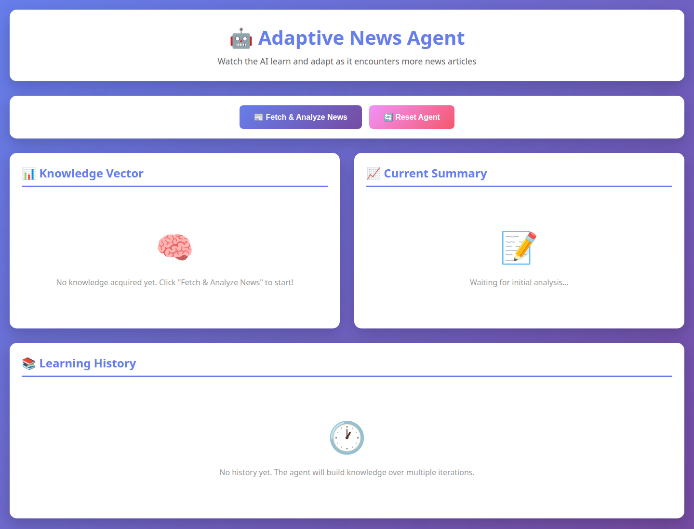
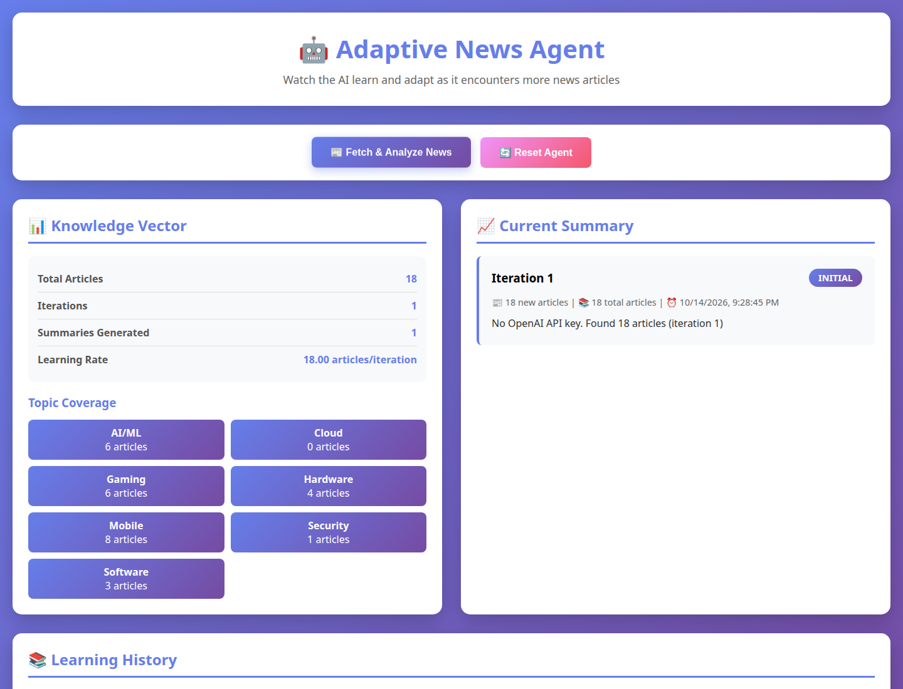
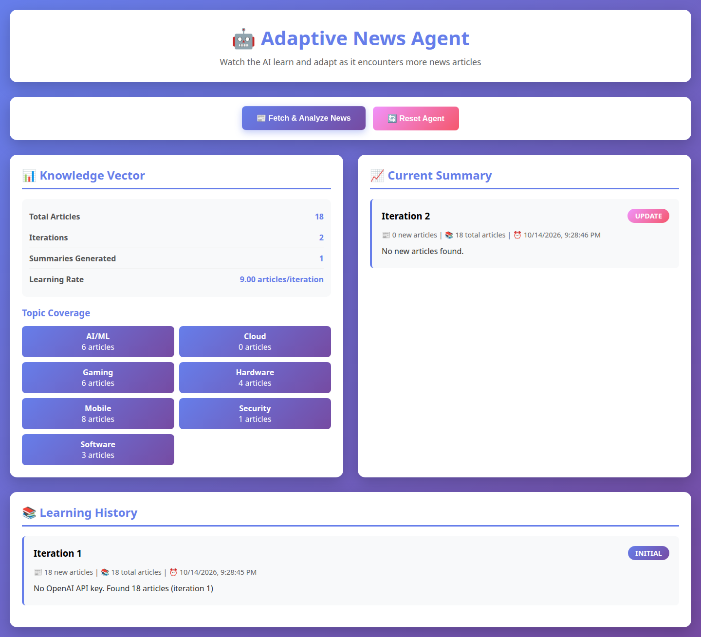

# Adaptive News Agent

Adaptive News Agent is a hackathon demo that pulls technology headlines, remembers the ones it has already seen, and summarizes what is new. Memory lives in the running process. The program does not train or fine-tune a model.

The owner is Shay Bouchles. `git shortlog` lists one author, `shaythegay13` (`shay.bouchles@gmail.com`), and one commit on 30 October 2025: "Initial commit: Adaptive News Agent with multi-temporal learning demos". The source and the GitHub repository metadata do not name the event, sponsor, or track. The checkout still contains the Eclipse LMOS Arc starter this demo grew out of: the Gradle project is named `windsurf-project`, and `SelfUpdater.agent` is an Arc agent file.

## What it does

| Entry point | What the code does |
| --- | --- |
| `news_fetcher.py` | Requests NewsAPI `GET /v2/top-headlines` with `category=technology`. Returns `"title description"` strings. Returns `[]` when `NEWS_API_KEY` is unset or the request fails. |
| `adaptive_news_agent.py` | Keeps a set of seen headline strings and a list of them. Counts keyword hits for AI/ML, Gaming, Mobile, Cloud, Hardware, Security, and Software. `learning_rate` is `article count / iteration count`. Optionally calls OpenAI `gpt-4o-mini`. Writes `agent_learning_history.json`. |
| `web_agent_demo.py` | Flask app on `0.0.0.0:5000` with one in-memory `AdaptiveNewsAgent`. Routes: `GET /`, `POST /api/fetch`, `GET /api/status`, `POST /api/reset`. |
| `temporal_news_agent.py` | Uses the same live headlines. Compares keyword counts on the last two iterations and labels topics emerging, declining, trending up, trending down, or stable. `learning_maturity` is `min(100, iteration / 10 * 100)`. Writes `temporal_learning_history.json`. |
| `simulated_temporal_demo.py` | Feeds five hard-coded headline batches into `TemporalNewsAgent`. Sleeps 2 seconds between batches. Does not call NewsAPI. |
| `multi_temporal_agent.py` | Calls NewsAPI `GET /v2/everything` for three windows: now–6 months, 6–12 months, and 1–3 years. Query: `technology OR AI OR software OR hardware OR gaming`. Keeps up to 50 articles that have a title and a description. Labels trends from the three counts. Writes `multi_temporal_analysis.json`. |
| `simulated_multi_temporal.py` | Runs the same comparison on 20 hard-coded articles per window. Writes `simulated_multi_temporal_results.json`. |
| `news_agent.py` | Builds a LangGraph with nodes `fetch_news` → `summarize` → end, when LangGraph imports. Exposes `news_graph`. The Flask app does not call it. |
| `src/main/kotlin/Main.kt` | Prints `Arc Agent Project` and `Use 'atlas SelfUpdater.agent' to run the agent`. It does not call the Python agents. |

Keyword lists are fixed strings in each module. One headline can increment more than one topic. In the multi-temporal lists, the token `app` is both a Mobile keyword and a Software keyword.

The OpenAI prompt asks the model to say what changed and to rate confidence from 0 to 100. The Python objects do not have a confidence field, and the code does not parse one out of the reply. With no `OPENAI_API_KEY`, the adaptive summary text is `No OpenAI API key. Found N articles (iteration N)`.

An empty result in `AdaptiveNewsAgent.generate_summary` increments `iteration` and returns `"No new articles found."` without appending that pass to `summaries_history`. The web UI always calls `generate_summary`. The CLI demo calls it only when the fetch returned new strings, and otherwise prints that nothing new was found.

`SelfUpdater.agent` sets the model to `gpt-4o` and the prompt to `Summarize the latest technology news:`. Running it requires the Arc `atlas` CLI, which is not in this repository. `langgraph_adapter.py` imports `atlas.sdk`, and that package is not in `requirements.txt`. `atlas_generated_factories.py` loads `.atlas/generated_factories.py`, which is not checked in.

## Screenshots

These are from a local Flask run on 14 October 2026. `NEWS_API_KEY` was set. `OPENAI_API_KEY` was not, so the summary is the fallback sentence. The first fetch stored 18 headlines. Topic counts are keyword hits on that response and will differ on a later fetch.

Empty dashboard:



After the first fetch:



After a second fetch of the same headline list. Deduplication is exact string equality, so the new-article count is 0. The iteration counter is 2 and `summaries_history` still has the first pass only, which is the empty-result path described above. Learning rate is `18 / 2 = 9`.



The page layout is a header, fetch and reset buttons, a knowledge panel, a current-summary panel, and a history list. Topic coverage is a CSS grid of cards in `templates/index.html`.

## Stack

Checked in this environment:

- Python 3.12.3, with dependencies from `requirements.txt`: `requests`, `langgraph`, `langchain`, `langchain-openai`, `langchain-core`, `python-dotenv`, `openai`, `flask`
- NewsAPI for live headlines
- OpenAI Chat Completions, model string `gpt-4o-mini`, when `OPENAI_API_KEY` is present
- Kotlin 2.1.21, Gradle 8.10.2, JDK 21
- Eclipse LMOS `arc-agents:0.185.0` and `arc-server:0.185.0`

`0.185.0` is the Maven Central coordinate. `0.185` is not published. Those jars carry Kotlin 2.1 metadata and declare JVM 21 as their minimum runtime, so the Gradle build uses Kotlin 2.1.21 and `jvmToolchain(21)`. `settings.gradle.kts` applies the Foojay toolchain resolver so Gradle can provision JDK 21 when the machine does not already have it.

## Architecture

```mermaid
flowchart TD
  browser[Browser] --> flask[web_agent_demo.py]
  flask --> adaptive[AdaptiveNewsAgent]
  cli[run_cli_demo.sh] --> adaptive
  temporalCli[run_temporal_demo.sh] --> temporal[TemporalNewsAgent]
  simDays[simulated_temporal_demo.py batches] --> temporal
  multiCli[run_multi_temporal.sh] --> multi[MultiTemporalAgent]
  simPeriods[simulated_multi_temporal.py articles] --> multi
  adaptive --> fetcher[news_fetcher.py]
  temporal --> fetcher
  fetcher --> headlines[NewsAPI top-headlines]
  multi --> everything[NewsAPI everything]
  adaptive --> openai[OpenAI gpt-4o-mini]
  temporal --> openai
  multi --> openai
  graph[news_agent.py LangGraph] --> fetcher
  graph --> openai
  kotlin[Main.kt] --> printAtlas[Prints the atlas command]
```

Flask state is the module-global `agent`. `POST /api/reset` replaces it. Stopping the process drops it. The CLI scripts write JSON files beside the code; those files are outputs, and the agents do not read them back on startup.

## Setup

```bash
python3 -m venv venv
source venv/bin/activate
pip install -r requirements.txt
cp .env.example .env
```

`.env.example` lists names only. Put values in `.env` on your machine. `.gitignore` ignores `.env`. The Python modules call `load_dotenv()`.

| Name | Read by |
| --- | --- |
| `OPENAI_API_KEY` | `news_agent.py`, `adaptive_news_agent.py`, `temporal_news_agent.py`, `multi_temporal_agent.py` |
| `NEWS_API_KEY` | `news_fetcher.py`, `multi_temporal_agent.py` |

```bash
./run_cli_demo.sh            # 3 iterations, 2 second delay
./run_cli_demo.sh 5 3        # iterations, then delay in seconds
./run_temporal_demo.sh       # 5 iterations, 3 second delay
./run_multi_temporal.sh
./run_simulated_demo.sh
./run_simulated_multi_temporal.sh
./run_web_demo.sh            # http://localhost:5000
```

Each script changes to its own directory, then runs `./venv/bin/python` when that file exists, otherwise `python3`.

The Kotlin stub:

```bash
./gradlew build
./gradlew run
```

`./gradlew run` prints the two lines from `Main.kt`. JDK 21 is required. The first wrapper run downloads Gradle 8.10.2.

`QUICK_START.md`, `DEMO_README.md`, `FEATURES.md`, and `README_old.md` are earlier notes. Where they disagree with this file, this file matches the code.

## Simulated multi-period run

`python simulated_multi_temporal.py` completed offline. Keyword hits on the bundled articles included:

| Topic | 1–3 years | 6–12 months | Recent | Label |
| --- | ---: | ---: | ---: | --- |
| AI/ML | 7 | 10 | 17 | dramatic_increase |
| Gaming | 4 | 2 | 1 | dramatic_decrease |
| Security | 2 | 2 | 2 | stable |

Those numbers are counts of keyword hits in `HISTORICAL_DATA`. The script then prints a fixed "Key Learnings" block, including a sentence about an industry shift. That block is not calculated from the table.

## Live historical fetch

`python multi_temporal_agent.py` with a NewsAPI key completed and stored 0 articles for each window. NewsAPI returned HTTP 426. A separate `/v2/everything` request with `from=2024-01-01` returned `parameterInvalid` and a message that the plan could request articles only as far back as 2026-09-13. The three windows in `MultiTemporalAgent.time_periods` all start before that date.

## Security

An earlier commit embedded a NewsAPI key in Python source. The current tree reads `NEWS_API_KEY` from the environment. Git history was not rewritten, so that credential is still in the old commit and should be rotated. `.env` was not in the tree. Do not commit key values.

## Contributors

Shay Bouchles, git author `shaythegay13` (`shay.bouchles@gmail.com`), is the only author in this repository's history.

## License

MIT. See [LICENSE](LICENSE). Copyright (c) 2025 Adaptive News Agent Project.
